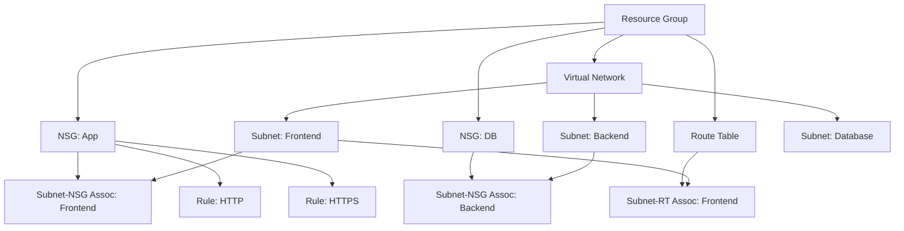

# Test Examples for `tf-graph-analysis`

This directory contains reference Terraform code used to test and demonstrate `tf-graph-analysis` across both supported execution patterns:

1. **Pattern A: Local Execution** (`examples/azure-local`) - Ran on the GitHub Actions runner.
2. **Pattern B: Remote Execution** (`examples/azure-tfc`) - Ran on HCP Terraform (Terraform Cloud).

---

## Architecture: Zero-Cost Azure Network

The shared module (`examples/modules/azure_network`) deploys a realistic, multi-tiered virtual network architecture that incurs **$0.00 / month in Azure charges**:

- **Resource Group** (`azurerm_resource_group`) - Free
- **Virtual Network** (`azurerm_virtual_network`) - Free
- **Subnets** (Frontend, Backend, Database) (`azurerm_subnet`) - Free
- **Network Security Groups & Rules** (`azurerm_network_security_group`, `azurerm_network_security_rule`) - Free
- **Route Table & Routes** (`azurerm_route_table`, `azurerm_route`) - Free
- **Subnet Associations** (`azurerm_subnet_network_security_group_association`, `azurerm_subnet_route_table_association`) - Free

### Dependency DAG Structure



This structure intentionally contains both parallel branches (NSGs and Route Tables created concurrently) and sequential dependency chains (VNet -> Subnets -> Associations), providing an ideal benchmark for Critical Path Method (CPM) analysis.

---

## Directory Structure

```text
examples/
├── modules/
│   └── azure_network/        # Shared module with zero-cost network resources
│       ├── main.tf
│       ├── variables.tf
│       └── outputs.tf
├── azure-local/              # Pattern A: Local execution on GitHub Actions runner
│   ├── main.tf
│   ├── providers.tf
│   └── variables.tf
└── azure-tfc/                # Pattern B: Remote execution via HCP Terraform
    ├── main.tf
    ├── providers.tf          # Contains cloud {} block
    └── variables.tf
```

## Terraform State Management (Pattern A)

In GitHub Actions (Pattern A), the runner environment is ephemeral. To evaluate and analyze `terraform plan` against already deployed resources, **the state cannot be stored on the runner local disk**. It must be placed in a persistent remote backend:

- **Storage**: Azure Blob Storage (`azurerm` backend)
- **Cost**: A small single state file (`< 50 KB`) in an Azure Storage container costs effectively **$0.00 / month** (well within Azure free allowance).
- **Authentication**: Keyless authentication via Azure Workload Identity Federation (OIDC) with `ARM_USE_OIDC: 'true'`. The Service Principal requires `Storage Blob Data Contributor` on the storage account/container.
- **Dynamic Configuration**: `examples/azure-local/providers.tf` declares an empty `backend "azurerm" {}`. Sensitive parameters (`resource_group_name`, `storage_account_name`, `container_name`) are supplied at runtime via GitHub Secrets (`AZURE_BACKEND_RG`, `AZURE_BACKEND_SA`, `AZURE_BACKEND_CONTAINER`) through `terraform init -backend-config="..."` to prevent leaking infrastructure names into public source code.

---

## Security & Sensitive Information in Public Repositories

When integrating with public GitHub repositories:
- **No hardcoded secrets**: All Azure Subscription IDs, Tenant IDs, Client IDs, and Storage Account names are supplied via GitHub Repository Secrets (`secrets.AZURE_*`) and masked with `::add-mask::`.
- **Plan logs not dumped to console**: In the test workflow, `terraform plan` logs are redirected to a local file (`tf_plan.log`) and read only by the analyzer, preventing Azure resource IDs from being printed in GitHub Actions job output.
- **Fork protection & Graceful skip**: Workflows gracefully skip execution if repository secrets are not configured or when triggered from external forks.

### Required GitHub Secrets

| Secret Name | Description | Used in |
| --- | --- | --- |
| `AZURE_CLIENT_ID` | Azure Entra App Registration Client ID (OIDC) | Pattern A (Local) |
| `AZURE_TENANT_ID` | Azure Entra Tenant ID | Pattern A (Local) |
| `AZURE_SUBSCRIPTION_ID` | Azure Subscription ID | Pattern A (Local) |
| `AZURE_BACKEND_RG` | *(Optional)* Resource Group of State Storage Account | Pattern A (Local) |
| `AZURE_BACKEND_SA` | *(Optional)* State Storage Account Name | Pattern A (Local) |
| `AZURE_BACKEND_CONTAINER` | *(Optional)* State Blob Container Name (default: `tfstate`) | Pattern A (Local) |
| `TFC_TOKEN` | HCP Terraform User or Team API Token | Pattern B (TFC) |
| `TFC_ORGANIZATION` | HCP Terraform Organization Name | Pattern B (TFC) |
| `TFC_WORKSPACE` | HCP Terraform Workspace Name | Pattern B (TFC) |
